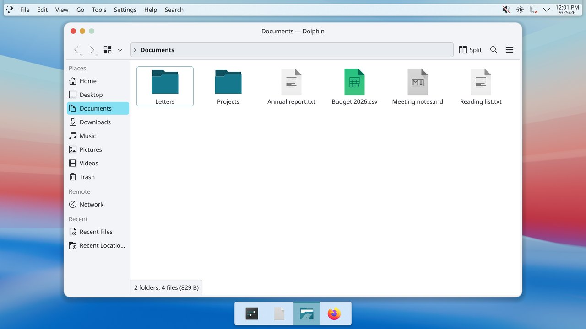
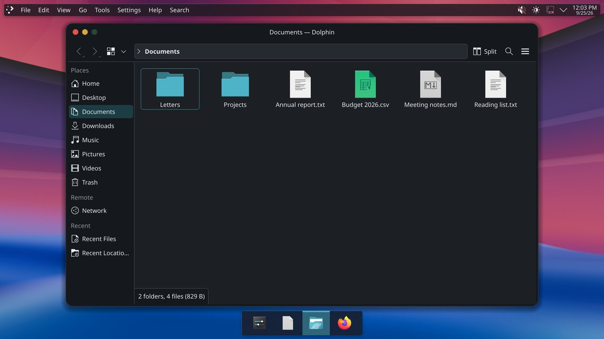
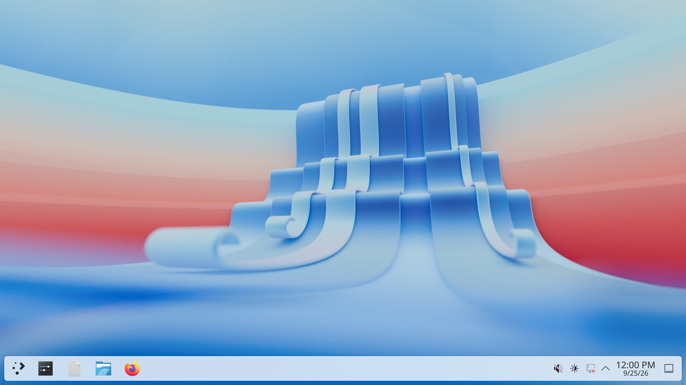
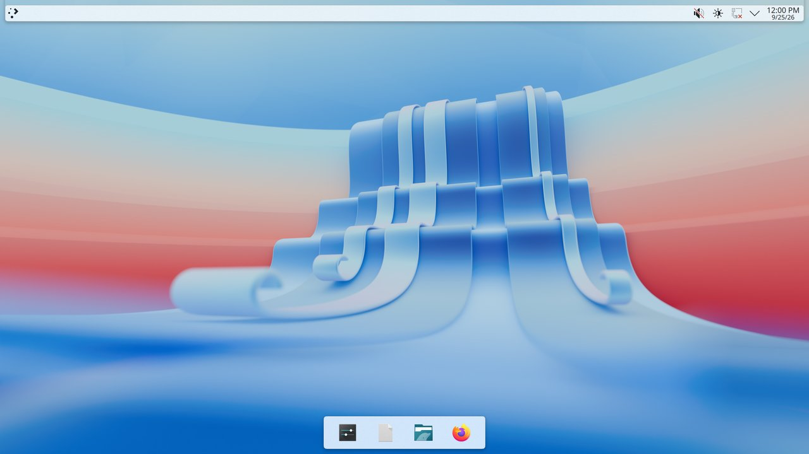
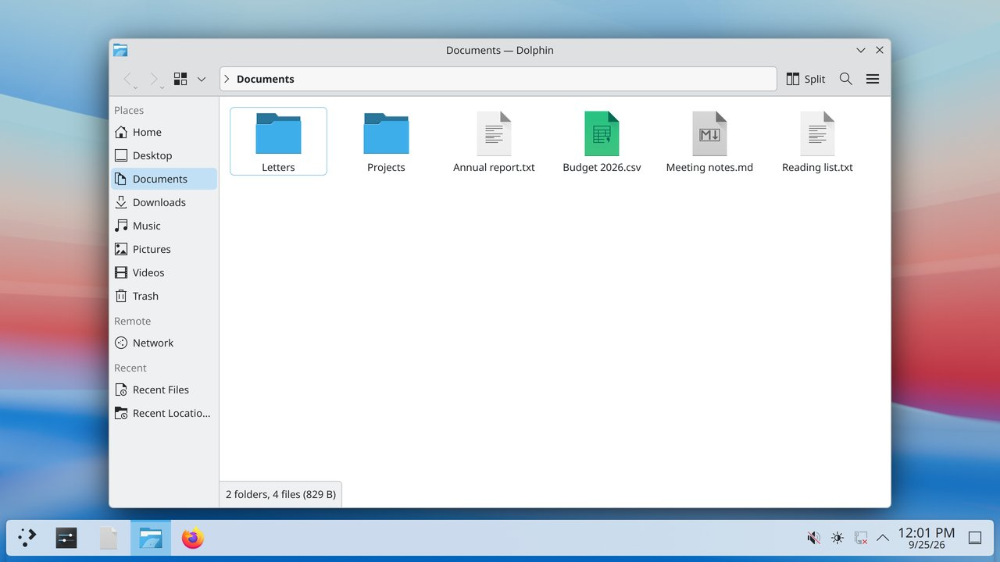
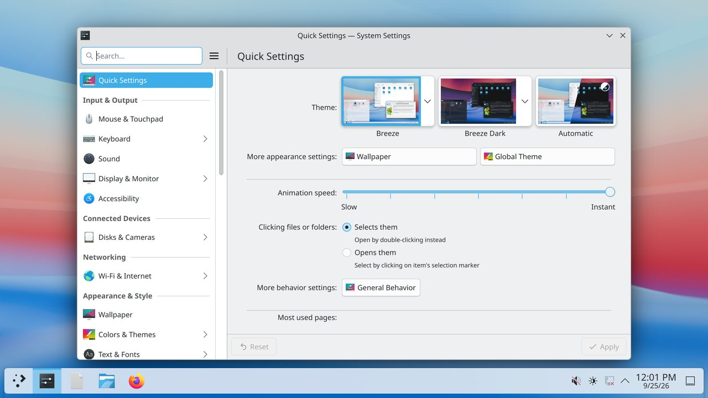
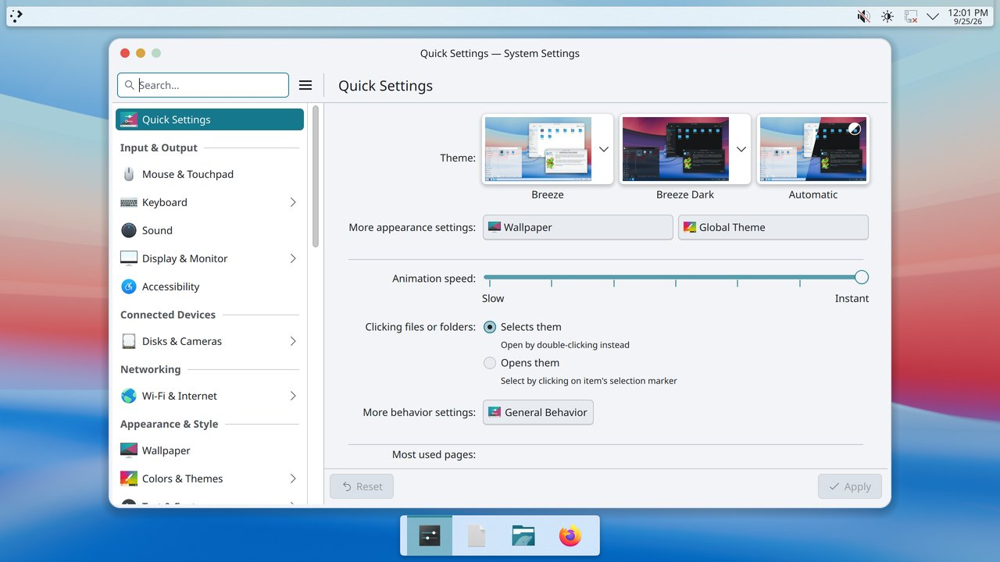
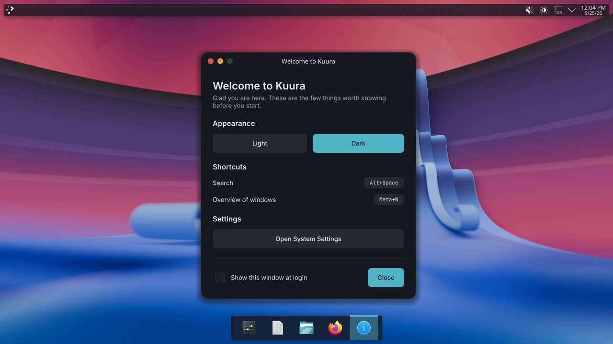
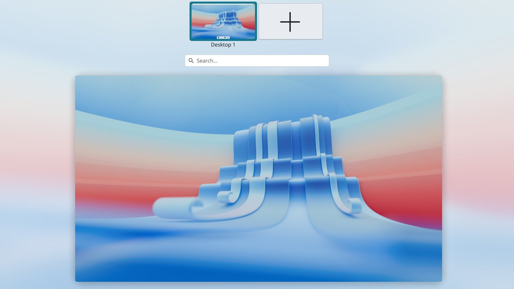

# kuura

**A calm, glass-like desktop on top of Arch Linux.** KDE Plasma 6 on Wayland, with
its own visual language: frosted glass, a top bar and a shelf, round window
buttons and a light and a dark mode that the whole desktop follows.

<p align="center">
  
  
</p>

**[Try it in a virtual machine](docs/TRY_IT.md)** · [Download](https://github.com/ville-Soiklander/kuura/releases) · [Install guide](docs/INSTALL.md)

## What it looks like

Stock KDE Plasma 6 with its Breeze defaults on the left, kuura on the right: same
virtual machine, same applications, same content.

<table>
  <tr><th>Before: stock Plasma</th><th>After: kuura</th></tr>
  <tr>
    <td></td>
    <td></td>
  </tr>
  <tr><td colspan="2" align="center"><b>The desktop</b>: one panel at the bottom becomes a frosted top bar and a centred shelf.</td></tr>
  <tr>
    <td></td>
    <td></td>
  </tr>
  <tr><td colspan="2" align="center"><b>Files</b>: round window buttons on the left, rounded corners on all sides, the project's accent colour.</td></tr>
  <tr>
    <td></td>
    <td></td>
  </tr>
  <tr><td colspan="2" align="center"><b>System Settings</b>: Qt applications follow the same colours, accent and window style.</td></tr>
</table>

<p align="center">
  
  
</p>

- **Frosted glass**: the top bar, the shelf and menus blur and tint what is behind
  them; light surfaces get a fine rim so they stay readable on a light wallpaper.
- **Round window buttons** on the left of every title bar, with rounded corners on
  all four sides and a soft shadow.
- **Light and dark** from the welcome window or the settings; the shell, the title
  bars and both Qt and GTK applications switch together.
- **One design source**: colours, radii, spacing, type, motion and the glass come
  from a single file, [`design/tokens.json`](design/tokens.json); icons, wallpapers
  and sounds are generated by this repository.

The screenshots are taken by the project's own test harness in a virtual machine
with 3D acceleration, from an image built from the same packages as the release.

**Status: first release (0.1.0), early.** The live ISO boots under BIOS and UEFI,
a graphical installer (Calamares) installs it, and every release is checked by a
screenshot harness on both the live desktop and a freshly installed system.
Expect rough edges; see [Known limits](#known-limits).

## Get it

The release page has the ISO (in two parts, joined with one command), its
checksum file (`SHA256SUMS`), the GPG signature of that file and the public
release key. [docs/TRY_IT.md](docs/TRY_IT.md) shows how to join, verify and run
it; in short:

```sh
cat kuura-*.iso.001 kuura-*.iso.002 > kuura.iso    # Windows: copy /b <part1> + <part2> kuura.iso
gpg --import kuura-release-signing-key.asc
gpg --verify SHA256SUMS.sig SHA256SUMS             # must report: Good signature
sha256sum --check --ignore-missing SHA256SUMS      # the ISO must report: OK
```

Release key fingerprint: `D443 8A0A 671E EFC3 7A01  9E73 A803 7E12 7876 7385`.

## Install

See [docs/INSTALL.md](docs/INSTALL.md): requirements, writing the ISO to a USB
stick, the live session and the installer pages. To try it without installing,
see [docs/TRY_IT.md](docs/TRY_IT.md).

## Known limits

- kuura has no package server of its own yet. kuura's own packages are updated
  only by installing a newer release.
- The automated tests run in virtual machines; behaviour on physical hardware is
  that of the stock Arch kernel and firmware packages.

## Build from source

Requirements: Linux (on Windows use WSL2), Podman or Docker, GNU make, Python 3.11.

```sh
cp .env.example .env          # optional local overrides; defaults live in .env.example
pip install -r requirements.txt
make check                    # forbidden-name check and linter
make test                     # unit tests
make repo                     # build and sign the package repository into .build/repo
make verify-install           # install the metapackage from it into a fresh container
make iso                      # build the live ISO into .build/iso
python -m design.generate     # write theme files for both modes into .build/generated
```

Builds run as an unprivileged user; rootless Podman is supported and recommended.
The build uses a throwaway signing key that exists only inside the build container.

Screenshot harness (boots virtual machines; needs QEMU):

| Target | What it does |
|---|---|
| `make vm-image` | build the guest image the harness boots |
| `make shots` | capture every state and compare with the goldens |
| `make goldens-review` | capture and produce a side-by-side review report |
| `make goldens-accept` | accept the captured shots as the new goldens (a human decision) |
| `make installed-verify` | boot the ISO, run a real install and diff the installed system |

The contracts behind these steps are in `docs/BUILD_CONTRACT.md`,
`docs/HARNESS_CONTRACT.md` and `docs/ISO_CONTRACT.md`.

## Layout

| Path | Content |
|---|---|
| `design/` | tokens, validator, generators (theme files, icons, wallpapers, sounds) and their tests |
| `packages/` | PKGBUILDs: the metapackage, the Frost compositor effect, shell, login screen, installer configuration, assets, browser policies |
| `build/` | container image, build, signing and install-verification scripts |
| `iso/` | the archiso profile and the ISO build scripts |
| `harness/` | screenshot and install-verification harness, goldens |
| `tools/` | repository guard rails (forbidden-name checker) |
| `tests/` | repository-level tests |
| `docs/` | contracts, pinned versions, glossary, install guide, third-party assets |
| `LICENSES/` | license texts and the component-to-license mapping |

## Rules of the project

- Everything visual is derived from `design/tokens.json`; nothing is hard coded.
- Every third-party asset is listed in `docs/ASSETS.md` before it is merged.
- The project uses its own names for every component (see `docs/GLOSSARY.md`).

## License

Themes, configuration and scripts are GPL-3.0-or-later (see `LICENSE`). The
license texts and the per-component summary are in [`LICENSES/`](LICENSES/README.md);
third-party assets and their licenses are listed in [`docs/ASSETS.md`](docs/ASSETS.md).
Packages installed from Arch Linux keep their own licenses.

The name kuura and the project's marks are covered separately, see
[TRADEMARKS.md](TRADEMARKS.md).
